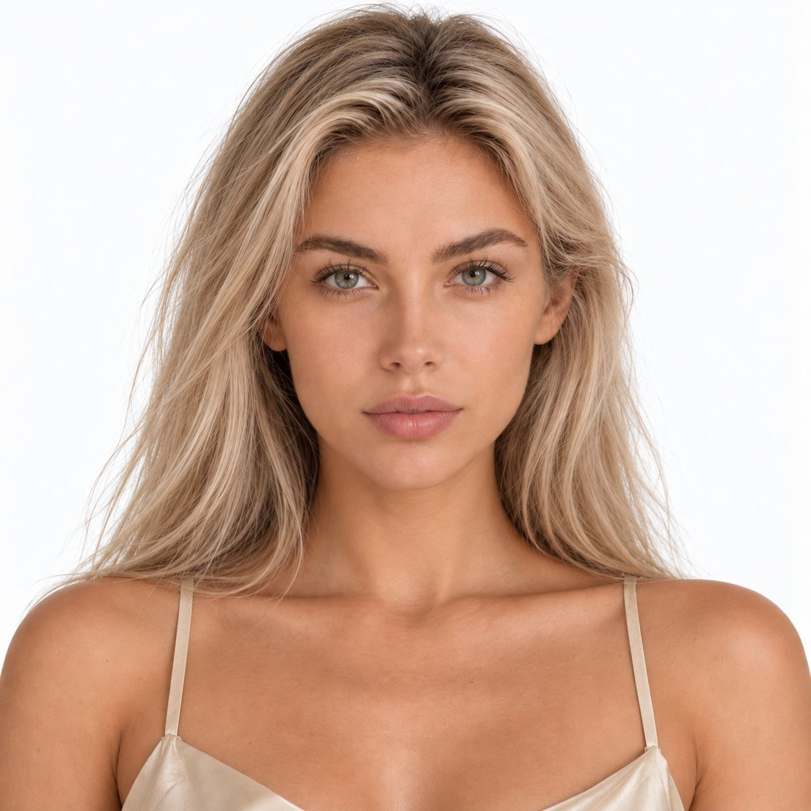

# 总办补充案例：定性标注与图片对应

本轮在总办面部特征V01索引中找到30条记录，选取两条与实际图片逐一核对。它们是新增对照样本，不是11月聊天中已完成的受控实验。

## 01-01

原记录观察到折角眉峰、灰绿虹膜、较宽颧区向下收窄、圆钝鼻尖与清晰唇峰。本轮查看照片可用于讨论眉峰与轮廓，但没有关键点测量。

原图文件：资产库/人物形象/01_甜美型/04_76_人物大头照_V02.png。SHA-256：cf89c8f6bcd708ac421999486082b600f467cd67db43d778656216da67afffb5，重算与索引一致。

## 01-03

原记录描述柔圆下巴、棕色虹膜、柔弧眉、闭口轻微笑意与略饱满下唇。微笑会影响嘴宽与脸颊，不把它与上一张当作严格中性实验对照。

原图文件：资产库/人物形象/01_甜美型/12_84_人物大头照_V01.png。SHA-256：72e2502b0787b4295af4d01e8976160377323ba72b2f786c65f4982dd3cab442，重算与索引一致。

## 记录状态

原标注为model-derived-candidate；agent-visual-reviewed、user-not-reviewed；qualitative-visual-only、no-landmark-measurements。鼻高与鼻尖前突需侧面确认；眼睑不能因睫毛/妆容遮挡而强判。类别名继承原素材目录，不代表对现实人物的年龄、身份或人格判定。

来源索引：总办/索引文件/资产检索/人物资料/研究/面部特征-V01.jsonl。本轮读取原始索引，不修改总办主库；原记录中的V盘路径在本机通过G盘对应文件验证。
