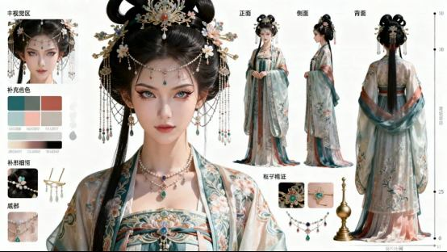

# 案例：面部设定与完整角色图

## 林知夏：从目标印象到参数

来源：人物DNA课件第10页。虚构角色32岁，目标为成熟、理性、自信、克制；参数为偏长鹅蛋脸、清晰颧区与流畅下颌、平直眉身微扬眉峰、细长杏眼和微挑眼尾、顺直鼻梁与圆润鼻尖、清晰唇形和略饱满下唇。神态单独记录。

图片只为风格参考，不是已经锁定的林知夏母版。原稿“右侧图片”已在整合PPT改为中性“配图”。案例尚未通过正侧背与表情派生身份测试。

## 古风角色：从脸部到资产包

来源：《第二講》第6页。图中包含脸部主视觉、全身视图、配饰与色板，可说明完整角色DNA不止五官，还要覆盖发型、体型、服装结构和配饰。

这张图与林知夏是不同案例、不同画风，不归同一角色ID。原描述的“8K”“商用级”不构成分辨率、质量或授权证明。仍需逐视图核对脸、服装扣位、背面结构和比例；没有本轮正式审核结论。
