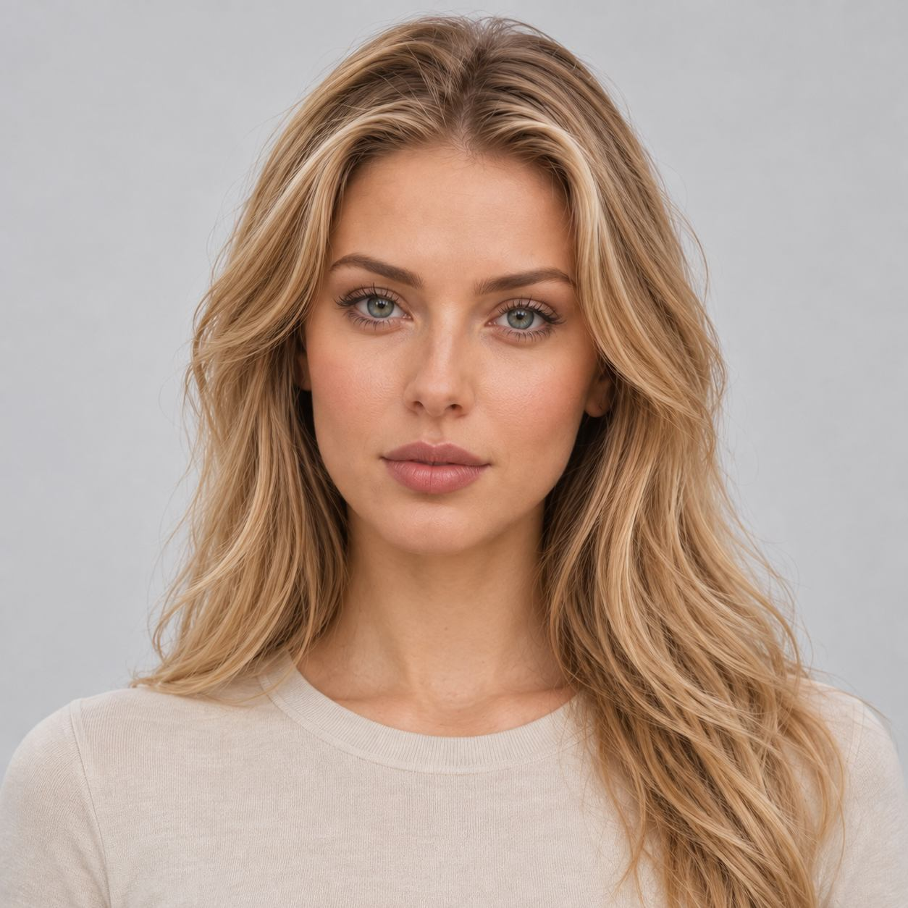
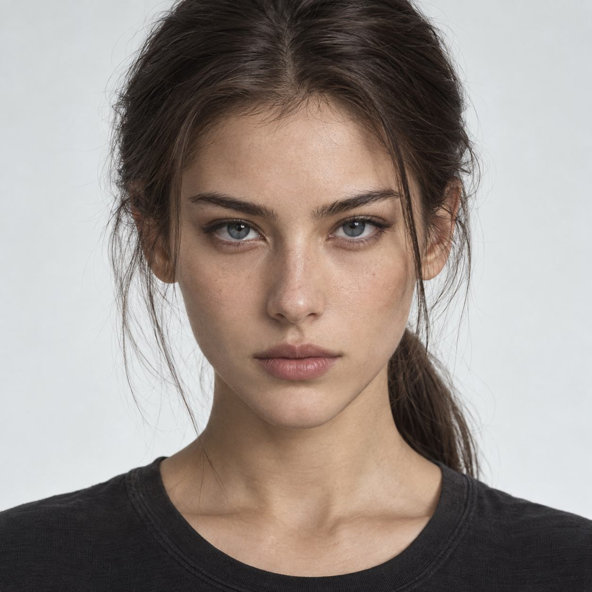
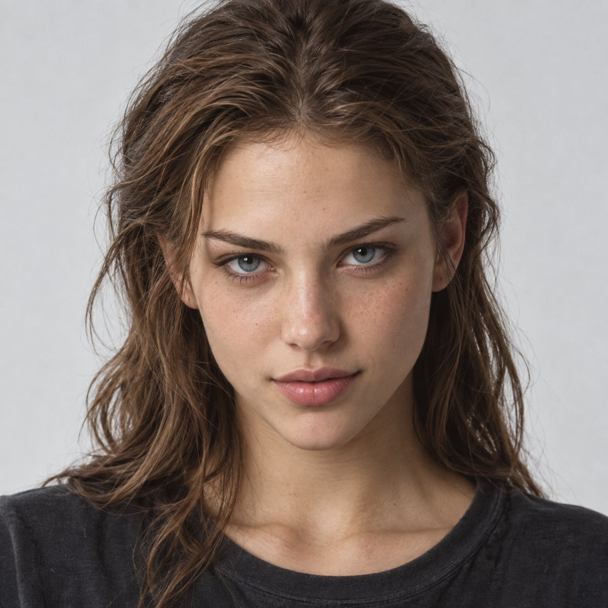

# 案例：脸型、眉眼与鼻唇的拆解

来源：人物DNA教学课件第4、5、6页。图片为原课件抽取的浏览副本；本轮不重新生成。

## 脸型：宽窄与转折

课件观察点为椭圆轮廓、颧区清晰度与下颌转折。记录颧区到下脸的收窄与转折，不把照片人物贴上现实性格标签。

## 眉眼：形态、比例与方向

分别记眉身走势、眼裂比例与眼尾方向；杏形、细长、微挑可以叠加。原图来自不同人物且发型、妆容和布光不同，属于观察案例，不是单变量实验。

## 鼻唇：局部要具体

课件描述鼻梁较直、鼻尖偏圆，唇峰清晰、下唇略饱满。正面图不能确认真实鼻尖前突度；唇色与唇线还受妆容影响。这里保留设计观察方法，不添加未经测量的角度或比例。

## 推进结果

从“温柔/御姐”等概括词，推进到可见结构。下一步是用同一母版、相同拍摄条件改变一项参数，而非把这些多变量照片当作因果证据。图片原始授权记录未在本轮逐张恢复，记录为来源课件参考，不能据此自动批准商业使用。
