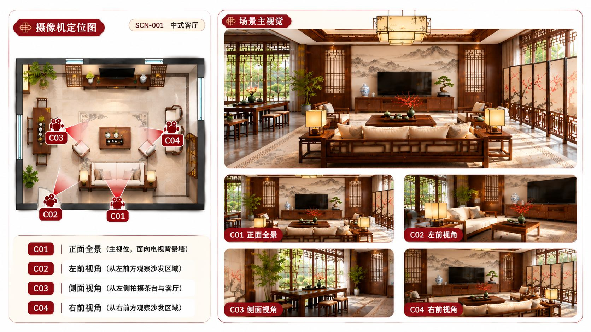
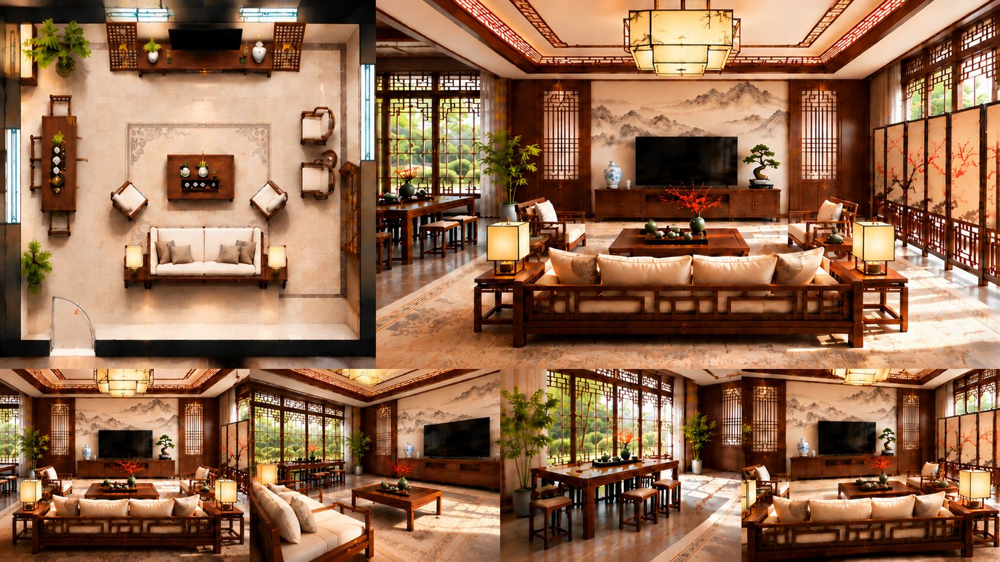
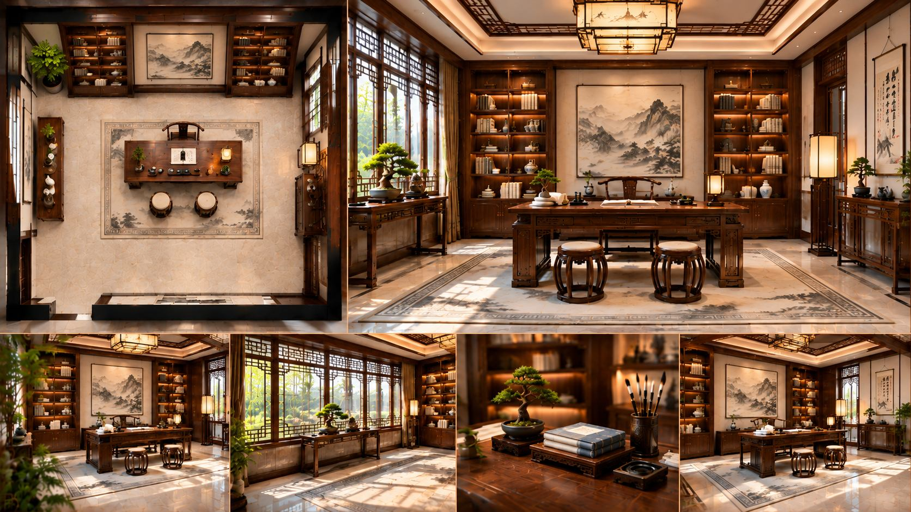
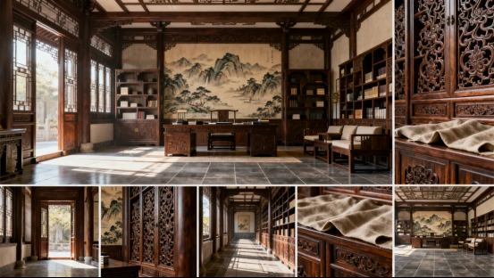

# 案例：中式客厅与书房

## 客厅：从机位标签检查可见物

来源：42页综合版第17–18页。第一张保留定位/机位图及多视角；第二张用于观察同组空间从不同方向的表现。

研究问题：俯视图的家具位置能否解释各机位画面，C01等标签是否指向正确观察方向？需要逐项核对门窗、沙发、桌子、主墙与遮挡。图片展示不等于已经通过三维拓扑验证。

## 书房：总体空间和局部细节分开

来源：42页综合版第19页、《第二講》第7页。整体图可检查桌、柜、窗、挂画的相对位置；木雕和织物近摄只提供材质信息，不能替代反向空间视角。

原研究六联图要求定位图和主视觉在上、四小图在下、最终无文字；课件带机位标注的教学图不必强行冒充无字最终交付图。二者用途不同。

## 研究结果与遗留问题

采用先布局/机位、后主视觉、再单张视角和检查的思路。旧书房草案入口方向冲突、机位视野以及独立摄影机图的位置仍待修订。上图已从实际课件提取，但不能确认与旧聊天报告的10张图库原图一一对应。源文件包部件、哈希和浏览图见[图片来源清单](../../案例图库/图片来源清单.md)。
