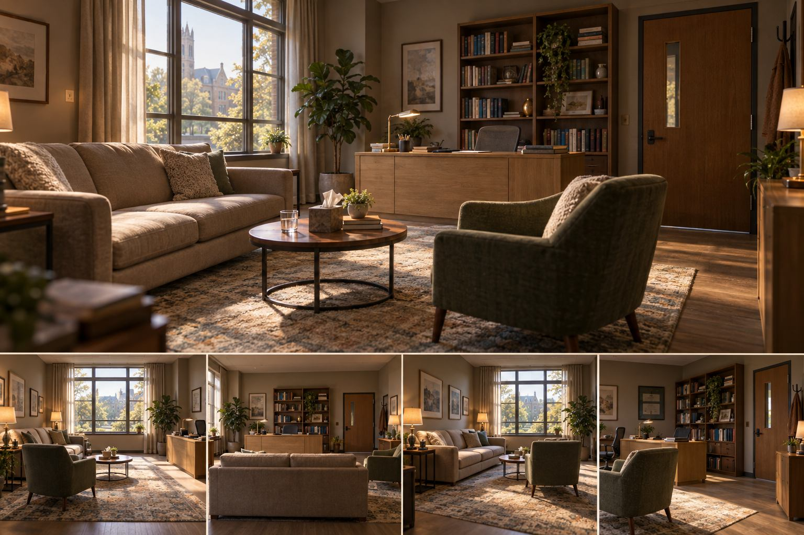
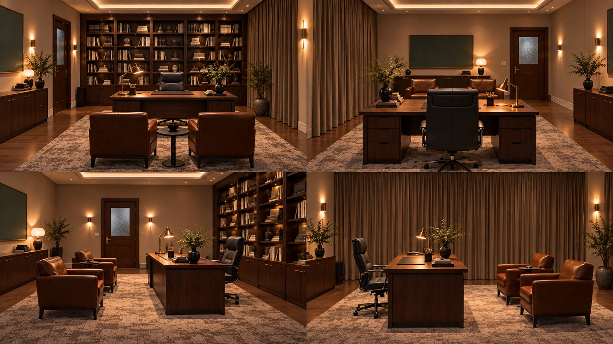

# 总办补充案例：现代空间对照

## 现代客厅/会客空间

来源为资产库内MI-0ec957473aa0图。可见布艺沙发、圆桌、单椅、大窗、书架和书桌。研究用途：选择桌、窗、门、书架作为锚点，检查不同画面中的位置与遮挡。

注意原文件名叫多角度场景板，但主图加四小图并不是本项目上2下4六联图，也没有定位图；不能把它当作旧现代公寓文字案例的生成验证结果。

## 现代书房四格图

来源为资产库内MI-6553032751eb图。可见木书架、书桌、办公椅、会客椅、帘、门和墙面矩形屏。正反两面适合讨论同一书桌两侧的椅子和墙面关系。

本轮只作图文观察，未对四格图完成几何重建。后续应先画布局再检查反向关系；外观相似不能独立证明空间一致。

## 与原研究文字的关系

原现代公寓文字案例规定南窗、北电视、东餐厅、西入口、米色L形沙发。补充图没有被证实符合这套布局；故保留为新增参考，不替换或冒充原案例图。研究文字的完整参数与冲突见[多视角研究过程](../多视角研究过程.md)。
