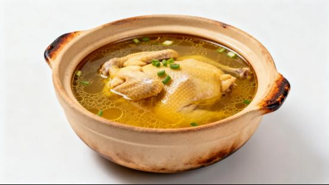
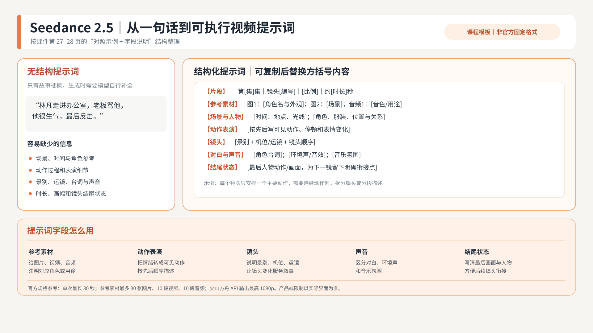

# 案例：道具描述与视频工作字段

## 砂锅鸡汤

来源：《第二講》第8页。可拆为粗陶锅体、双耳结构、烧边、暖金汤色、鸡肉与葱花等可见特征，附白底斜俯视的呈现方式。

原描述同时出现“整鸡”和“半只完整炖煮土鸡”，文字定义需先统一；图只能说明这一视角外观，不能单凭它确定尺寸、背面或实际持握关系。道具正式入库前补尺度参照和剧情所需状态。

## 视频提示词课程模板

来源：用户提供的Seedance_2.5_提示词模板.png。以“走进办公室—被老板责备—生气反击”的概述为反例，补齐参考素材、场景人物、动作表演、镜头、对白声音和结尾状态。此处是图文结构案例，不是已经生成了该段视频。

保留原图以保存研究过程；底部模型规格属于历史文字，本轮未重核，不作为当前规格承诺。63页PPT的演示视图裁掉该行，PNG原文件未修改。课程模板不是官方固定语法。

研究中的“8K固定质量词”“统一负面词”等写法曾被质疑，当前用具体画面、动作与连续性要求替代空泛保证。提示词研究方法保留，不把生成提示词作为独立资产入库。
